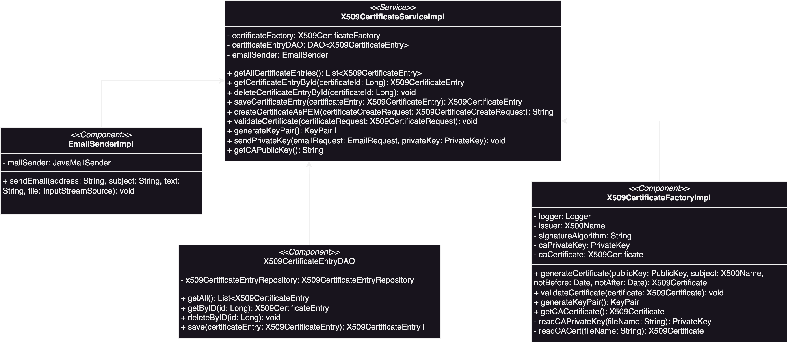

# CUHK Certification Authority (Backend)

## Run Environment
### Configurations
1. Language: Java 17
2. Framework: [SpringBoot](https://spring.io/projects/spring-boot)
3. Database: Postgresql
4. Caching: Hazelcast
5. OAuth: GitHub
6. Email: Gmail

CA related configurations stored in `resources/config/ca.properties`

Application related configurations stored in `resources/application.properties`

### Quickstart
1. Build Dependencies
```shell
./gradlew clean build
```
2. Run `CertificationAuthorityApplication`

## Structure
### Files
```
com.chuk_ca.sprint_initializer
│
├── config
│   ├── BouncyCastleConfig            # Configuration for BouncyCastle cryptographic provider
│   ├── HazelcastConfig               # Configuration for Hazelcast caching
│   ├── WebSecurityConfig             # Security configuration, includes OAuth and certificate bypass
│
├── controller
│   └── X509CertificateController     # REST controller for X509 certificate-related operations
│
├── model
│   ├── CAConfigPaths                 # Stores paths related to the CA configuration
│   ├── EmailRequest                  # Request DTO for emailing the private key
│   ├── PublicKeyResponse             # Response DTO for creating the key pair
│   ├── X509CertificateCreateRequest  # Request DTO for creating a X509 certificate
│   ├── X509CertificateEntry          # Entity class representing a X509 certificate log entry in the database
│   ├── X509CertificateRequest        # Request DTO for handling a X509 certificate
│   ├── X509CertificateResponse       # Response DTO for representing a X509 certificate
│
├── repository
│   └── X509CertificateEntryRepository # Repository interface for database operations on X509 certificate entries
│
├── service
│   ├── dao
│   │   ├── DAO                       # Interface for Data Access Object
│   │   └── X509CertificateEntryDAO   # Implementation of DAO for X509CertificateEntry
│   ├── util
│   │   ├── ConfigFileLoader           # Interface for loading configuration files (specifically CA configurations)
│   │   ├── ConfigFileLoaderImpl       # Implementation of the configuration file loader
│   │   ├── EmailSender                # Interface for sending emails
│   │   └── EmailSenderImpl            # Implementation for sending emails
│   └── x509
│       ├── X509CertificateFactory     # Interface for handling X509 certificate related operations
│       ├── X509CertificateFactoryImpl # Implementation of the X509 certificate factory
│       ├── X509CertificateUtils       # Utility class for handling certificate-related utilities
│       ├── X509CertificateService     # Interface for X509 certificate-related services
│       └── X509CertificateServiceImpl # Implementation of X509 certificate services
│
└── CertificationAuthorityApplication # Main application class for initializing the Spring Boot application
```

### Service


### Tests
`CertificationAuthorityApplicationTests`: test the application start up

`X509CertificateIntegrationTests`: test the controller layer (API endpoints)

`X509CertificateServiceTests`: test the service layer


## API Endpoints
## Getting Started
## Next Step