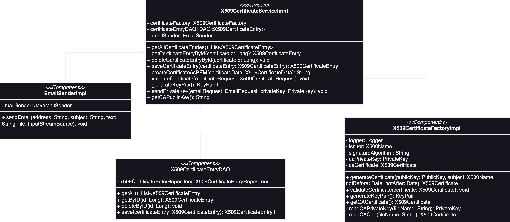

# CUHK Certification Authority (Backend)

## Table of Contents
1. [Introduction](#introduction)
2. [Run Environment](#run-environment)
   1. [Configurations](#configurations)
   2. [Quickstart](#quickstart)
3. [Structure](#structure)
   1. [Files](#files)
   2. [Service UML](#service-uml)
   3. [Tests](#tests)
4. [API Endpoints](#api-endpoints)
   1. [Get All Certificate Entries](#get-all-certificate-entries)
   2. [Get Certificate Entry by ID](#get-certificate-entry-by-id)
   3. [Delete Certificate Entry](#delete-certificate-entry)
   4. [Save Certificate Entry](#save-certificate-entry)
   5. [Create Certificate](#create-certificate)
   6. [Validate Certificate](#validate-certificate)
   7. [View Certificate as JSON](#view-certificate-as-json)
   8. [Generate Key Pair](#generate-key-pair)
   9. [Get CA Public Key](#get-ca-public-key)
5. [Next Step](#next-step)
   1. [Staff Portal](#staff-portal)
   2. [User Portal](#user-portal)
   3. [Email Ticketing](#email-ticketing)
   4. [ACME Server](#acme-server)
   5. [Security](#security)

## Introduction


## Run Environment
### Configurations
1. Language: Java 17
2. Framework: [SpringBoot](https://spring.io/projects/spring-boot)
3. Database: Postgresql
4. Caching: Hazelcast
5. OAuth: GitHub
6. Email: Gmail
7. Deployment: Docker Container (TODO)

CA related configurations stored in `resources/config/ca.properties`

Application related configurations stored in `resources/application.properties`

### Quickstart
**Intellij**
1. Build Dependencies
```shell
./gradlew clean build -x test
```
*Note: Tests are excluded from the build because an isolated test environment is not configured. This means the tests may fail if they are run during the build process.*
2. Run `CertificationAuthorityApplication`

**Docker Container** (TODO)

## Structure
### Files
```
com.chuk_ca.sprint_initializer
│
├── config
│   ├── BouncyCastleConfig            # Configuration for BouncyCastle cryptographic provider
│   ├── HazelcastConfig               # Configuration for Hazelcast caching
│   ├── WebSecurityConfig             # Security configuration, includes OAuth and certificate bypass
│
├── controller
│   └── X509CertificateController     # REST controller for X509 certificate-related operations
│
├── model
│   ├── CAConfigPaths                 # Stores paths related to the CA configuration
│   ├── EmailRequest                  # Request DTO for emailing the private key
│   ├── PublicKeyResponse             # Response DTO for creating the key pair
│   ├── X509CertificateCreateRequest  # Request DTO for creating a X509 certificate
│   ├── X509CertificateData           # Model containing the information needed for creating a X509 certificate
│   ├── X509CertificateEntry          # Entity class representing a X509 certificate log entry in the database
│   ├── X509CertificateViewRequest    # Request DTO for viewing a X509 certificate
│   ├── X509CertificateViewResponse   # Response DTO for representing a X509 certificate in a view request
│
├── repository
│   └── X509CertificateEntryRepository # Repository interface for database operations on X509 certificate entries
│
├── service
│   ├── dao
│   │   ├── DAO                       # Interface for Data Access Object
│   │   └── X509CertificateEntryDAO   # Implementation of DAO for X509CertificateEntry
│   ├── util
│   │   ├── ConfigFileLoader           # Interface for loading configuration files (specifically CA configurations)
│   │   ├── ConfigFileLoaderImpl       # Implementation of the configuration file loader
│   │   ├── CSRUtils                   # Utility class for handling CSR-related utilities
│   │   ├── EmailSender                # Interface for sending emails
│   │   └── EmailSenderImpl            # Implementation for sending emails
│   └── x509
│       ├── X509CertificateFactory     # Interface for handling X509 certificate related operations
│       ├── X509CertificateFactoryImpl # Implementation of the X509 certificate factory
│       ├── X509CertificateUtils       # Utility class for handling certificate-related utilities
│       ├── X509CertificateService     # Interface for X509 certificate-related services
│       └── X509CertificateServiceImpl # Implementation of X509 certificate services
│
└── CertificationAuthorityApplication # Main application class for initializing the Spring Boot application
```

### Service UML


### Tests
`CertificationAuthorityApplicationTests`: test the application start up

`X509CertificateIntegrationTests`: test the controller layer (API endpoints)

`X509CertificateServiceTests`: test the service layer


## API Endpoints
### Get All Certificate Entries
- **URL**: `/certificates`
- **Method**: `GET`
- **Description**: Retrieves a list of all certificate entries.
- **Response**:
  - **200 OK**: Returns a list of `X509CertificateEntry`.
  - **204 NO CONTENT**: If no certificate entries are found.
- **Example Response**:
  ```json
  [
    {
      "id": 0,
      "certificate": "PEM encoded certificate",
      "issuanceDate": "",
      "issuancePerson": ""
    }
  ]
  ```

### Get Certificate Entry by ID
- **URL**: `/certificates/{certificateId}`
- **Method**: `GET`
- **Description**: Retrieves a certificate entry by its ID.
- **Path Parameters**:
  - `certificateId` (Long): The ID of the certificate entry.
- **Response**:
  - **200 OK**: Returns the `X509CertificateEntry` object.
  - **404 NOT FOUND**: If the certificate entry is not found.
- **Example Response**:
  ```json
    {
      "id": 0,
      "certificate": "PEM encoded certificate",
      "issuanceDate": "2023-01-01",
      "issuancePerson": "James Chen"
    }
  ```

### Delete Certificate Entry
- **URL**: `/certificates/{certificateId}`
- **Method**: `DELETE`
- **Description**: Deletes a certificate entry by its ID.
- **Path Parameters**:
  - `certificateId` (Long): The ID of the certificate to delete.
- **Response**:
  - **204 NO CONTENT**: If the deletion was successful.

### Save Certificate Entry
- **URL**: `/certificates`
- **Method**: `POST`
- **Description**: Save a new certificate entry.
- **Request Body**:
  ```json
  {
      "id": 0,
      "certificate": "PEM encoded certificate",
      "issuanceDate": "2023-01-01",
      "issuancePerson": "James Chen"
    }
  ```
- **Response**:
  - **200 OK**: Returns the saved `X509CertificateEntry` object.

### Create Certificate
- **URL**: `/certificates/create`
- **Method**: `POST`
- **Description**: Generates an X509 certificate as a PEM file.
- **Request Body**:
  ```json
  {
    "csr": "PEM encoded CSR",
    "notBefore": "2024-10-09T09:44:55.887+00:00",
    "notAfter": "2024-10-09T09:44:55.887+00:00"
  }
  ```
- **Response**:
  - **200 OK**: Returns the PEM-encoded certificate.
  - **400 BAD REQUEST**: If the request is invalid (e.g., invalid public key, certificate errors).

### Validate Certificate
- **URL**: `/certificates/validate`
- **Method**: `POST`
- **Description**: Validates an X509 certificate.
- **Request Body**:
  ```json
  {
    "pemContent": "PEM encoded certificate"
  }
  ```
- **Response**:
  - **200 OK**: The certificate is valid.
  - **400 BAD REQUEST**: If the certificate is invalid or not yet valid/expired.

### View Certificate as JSON
- **URL**: `/certificates/view-json`
- **Method**: `POST`
- **Description**: Converts the X509 certificate to a JSON response.
- **Request Body**:
  ```json
  {
    "pemContent": "PEM encoded certificate"
  }
  ```
- **Response**:
  - **200 OK**: Returns the certificate details in JSON format.

### Generate Key Pair
- **URL**: `/certificates/generate-keys`
- **Method**: `POST`
- **Description**: Generates a key pair and sends the private key via email.
- **Request Body**:
  ```json
  {
    "address": "email@example.com"
  }
  ```
- **Response**:
  - **200 OK**: Returns the public key in PEM format.
  - **500 INTERNAL SERVER ERROR**: If there is an error in key generation or email sending.

### Get CA Public Key
- **URL**: `/certificates/ca-public-key`
- **Method**: `GET`
- **Description**: Retrieves the CA's public key.
- **Response**:
  - **200 OK**: Returns the PEM-encoded CA public key.
  - **400 BAD REQUEST**: If there is an error fetching the CA's certificate.

## Next Step
Those are rough ideas for building a complete and usable certificate authority. All of the points listed below need to be further researched and evaluated.
### Staff Portal
1. Handling of CA staff's identities using MongoDB like in 林工程师‘s demonstration?
2. Able to track/view the issuance of certificate creations and view the ongoing CSRs. 
3. Other...
### User Portal
1. Guiding the user when it comes of certificate request. Such as creating the CSR and sending it. 
2. Other...
### Email Ticketing
1. For managing the communication between the applicants and the CA.
2. The ticketing system should be added to the staff portal.
### ACME Server
1. Automate the issuance of TSL certificate. 
2. Check this [existing implementation](https://github.com/knrdl/acme-ca-server).
### Security
1. Secure storage of CA's own private key.
2. Other...